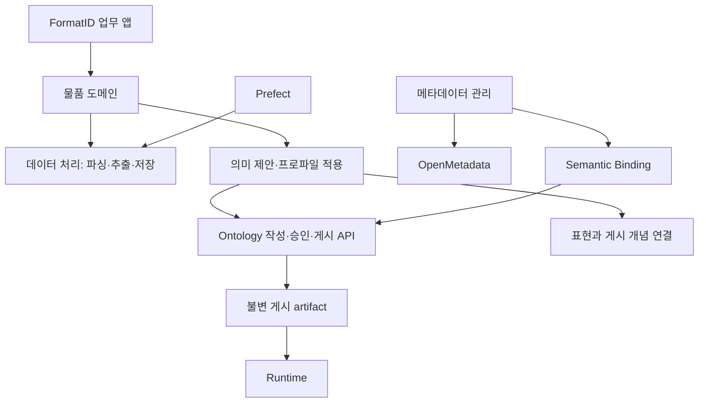

# 아키텍처

Teoria는 데이터 자산과 업무 의미를 연결하는 플랫폼이다.
플랫폼 위에 물품·법령 도메인이 있고, FormatID는 그 기능을 사용하는 업무 앱이다.
플랫폼의 주 영역은 데이터(`data/`)·Ontology(`ontology/`)·향후 AI(`ai/`)다.
MLOps(`mlops/`)는 별도로 제공한다. AIP·Agent·Tool 실행 계층은 현재 미구현이며,
`ai/`에는 예약 목적을 설명하는 README만 둔다. 기존 Codex 연결과 기능별 AI 처리는 소유 위치에 유지한다.

## 데이터·Ontology·앱

| 영역 | 책임 | 대표 코드 |
|---|---|---|
| 데이터 운영 | 수집 계약, 원본 저장, 재실행·checkpoint | `platform/data/operations/` |
| 메타데이터 | OpenMetadata 조회, 진단 제안, 검토·적용 | `platform/data/metadata/` |
| Ontology | 업무 개념·속성·관계의 작성, 검토, 게시 | `platform/ontology/authoring/` |
| 의미 연결 | 개념과 용어·자산·API·Capability 연결 | `platform/ontology/bindings/` |
| 실행 계약 | Source·Mapping·Capability 검증과 artifact 생성 | `platform/ontology/contracts/` |
| Runtime | 게시 artifact를 이용한 조회·실행·Context | `platform/ontology/runtime/` |
| 업무 도메인 | 물품 추출·정규화·표현 연결, 법령 수집·검색 | `domains/` |
| AI (예정) | 향후 AIP 예약 영역; 현재 실행 기능 없음 | `platform/ai/` |
| MLOps | 공통 모델 목록·버전·운영 API | `platform/mlops/` |
| 예제 | 합성 고객 이탈 데이터·학습·배포·추론 | `examples/customer_churn/` |
| 업무 앱 | 사용자 입력·권한 확인·업무 결과 제공 | `apps/formatid/` |

폴더는 코드 소유권이고 API·Worker·DB는 실행·저장 경계다.
현재는 Python 프로젝트 하나를 유지하면서 API·MCP·역할별 Worker를 별도 프로세스와 이미지로 실행한다.

## 물품 처리의 경계

1. `domains/goods/data_processing/`이 원문에서 엔티티·관계·속성·조건과 근거를 추출한다.
2. `domains/goods/normalization/meaning_proposals/`가 게시 정의와 비교하고 의미 후보를 만든다.
3. `platform/ontology/authoring/`가 새 업무 정의의 검토·승인·게시를 맡는다.
4. `domains/goods/expression_links/`가 원문 표현과 게시 개념을 연결한다.
5. `domains/goods/normalization/application/`이 고정된 프로파일·규칙을 적용한다.
6. `apps/formatid/`가 결과를 업무 화면에 제공한다.

이 순서는 책임 구분이다. 모든 실행이 새 Ontology를 게시하는 것은 아니다.
추출 표준 자동 채택은 draft이며, Published Ontology 승인이 아니다.
Worker의 의미 쓰기는 인증된 Admin HTTP API를 거친다.
구축 실행이 Ontology/프로파일과 표현 연결의 승인을 조립하고, 적용 실행은 고정 snapshot만 사용한다.
후보 수집도 승인된 연결을 사용하며 별칭 매칭을 승인 근거로 대체하지 않는다.
후보·연결 제안 판단은 `normalization/candidates/`, 연결 검토 상태·승인 정책은 `expression_links/`가 맡는다.
`workflows/`의 표준 구축 Flow·Task는 이 판단을 호출하고 I/O·실행 순서·대기·재개를 조립한다.
프로파일의 게시 버전·snapshot·문서 해석 승인·단계별 코드 버전을 함께 고정한다.
문서별 소유 대상·scope·구성 수량 해석은 물품 도메인의 별도 승인으로 관리한다.
요청·적용 본문은 객체 저장소, 승인·참조·감사는 Application DB에 둔다. Runtime은 승인 상태를 재확인해 만든 고정 view만 읽는다.

## 저장 권위

| 저장소 | 소유하는 내용 |
|---|---|
| OpenMetadata | 자산·스키마·설명·Owner·Tag·Glossary·물리 lineage·quality·usage |
| Application DB | Business Ontology·Binding·진단 제안/검토/적용·Context·물품 프로파일/표현 연결/승인 이력 |
| Data DB | 수집·처리 실행 상태·문서별 요약·산출물 URI와 checksum |
| 객체 저장소 | 원본·문서별 관찰 본문·추출/적용 결과·불변 게시 artifact |
| Prefect | Workflow 실행·스케줄·재시도·pool·queue |

OpenMetadata entity 상태를 Teoria DB에 복제하지 않는다. 외부 자산은 `MetadataTargetRef`로 참조한다.
기본 의미 경로는 `Physical Asset → Glossary Term → Ontology`다.

## 지켜야 할 경계

- `platform`은 `domains`·`apps`·`examples`를 import하지 않는다. 도메인 연결은 `entrypoints/composition/`에서 주입한다.
- 앱은 SQL과 업무 규칙을 소유하지 않는다. 도메인 서비스가 처리와 저장을 맡는다.
- Ontology에는 지속 가능한 업무 의미를 둔다. API 응답·Runtime projection을 업무 개념으로 만들지 않는다.
- Mapping은 `source record → runtime object`, Binding은 `concept ↔ 의미 대상`이다.
- AI 출력은 Suggestion이다. 승인·적용 성공 전에는 authoritative metadata가 아니다.
- 게시 revision은 수정하지 않는다. Runtime은 checksum을 검증한 버전 artifact만 적재한다.

## Palantir에서 참고한 점

공개 Foundry 문서의 [데이터 통합](https://www.palantir.com/docs/foundry/data-integration/overview/),
[Ontology](https://www.palantir.com/docs/foundry/ontology/overview/),
[Workshop](https://www.palantir.com/docs/foundry/workshop/overview/)에서 데이터 준비·업무 의미·앱의
역할 분리를 참고했다. [Actions](https://www.palantir.com/docs/foundry/action-types/overview/)의
입력·권한·변경 검증을 참고해 문서 해석의 상태 전이·원문 보존·감사를 소유 서비스에서 검증한다. 이 저장소 구조는 Teoria의 구현 선택이며 Palantir 내부 코드 구조를 뜻하지 않는다.

구체적인 변경 위치는 [저장소 구조](repository-structure.md), 현재 범위는 [로드맵](../roadmap.md)을 읽는다.

## MLOps 예제 실행 환경

Compose에서 Prefect Docker Worker가 학습 실행마다 전용 이미지의 컨테이너를 생성한다.
서빙 이미지는 별도로 빌드·배포하고 MLflow의 고정 모델 버전과 checksum으로 로드한다.
예제 업무 정책은 `examples/customer_churn/`, pool·자원·네트워크 정책은
`deploy/compose/prefect/model_operations.yaml`, 공통 등록은 `integrations/prefect/`가 소유한다.

[Palantir 모델 통합](https://www.palantir.com/docs/foundry/model-integration/overview/)의
실행 환경·모델 버전·재현성 분리 원칙을 참고했다. Teoria는 Prefect·MLflow·Compose를 사용하며,
Ontology를 학습 실행의 필수 조건으로 추가하지 않는다.
[Prefect Docker Worker](https://reference.prefect.io/prefect_docker/worker/)의 실행별 컨테이너 방식을 사용한다.
K3s MLOps 실행 경로와 실제 운영 배포 검증은 별도 작업이다.

컨테이너 Image Registry는 모델 버전을 관리하는 MLflow Model Registry와 분리한다.
이미지 파일은 Registry의 영구 저장 공간, 데이터·모델 산출물은 기존 객체 저장소가 소유한다.
HTTP 연동은 `integrations/image_registry.py`, 인증된 조회는 `platform/mlops/image_registry_router.py`,
Admin 조립은 composition이 맡는다. Registry 설치는 플랫폼 lifecycle과 독립된 선택형 기반이다.
[이미지 Registry 설계·검증 범위](../deployment/image_registry.md)를 따른다.
