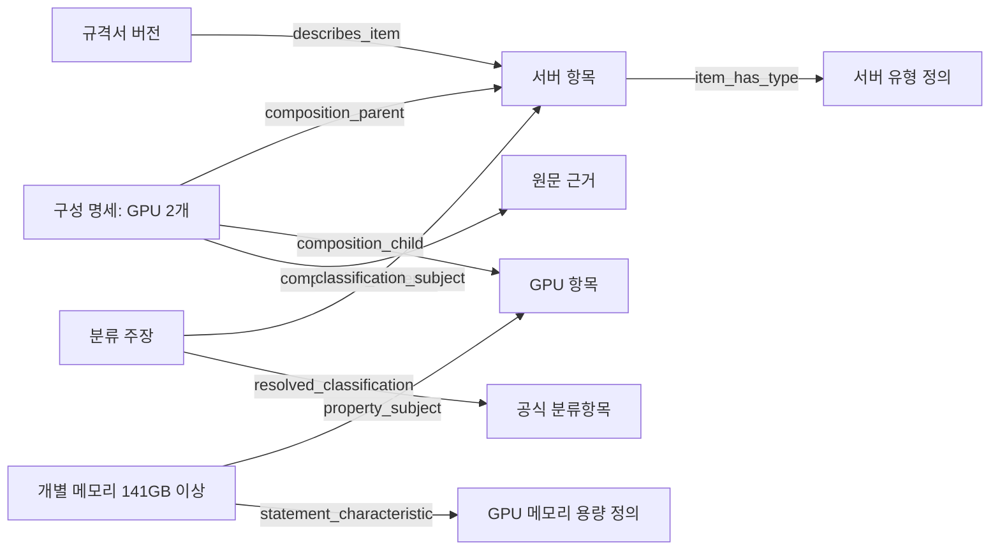
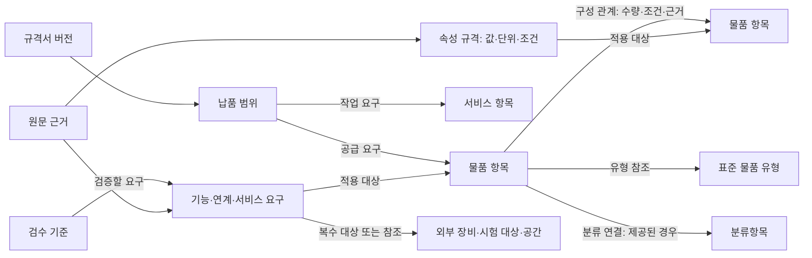
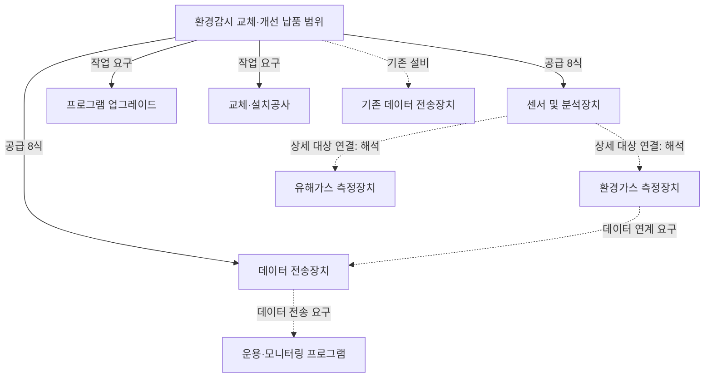
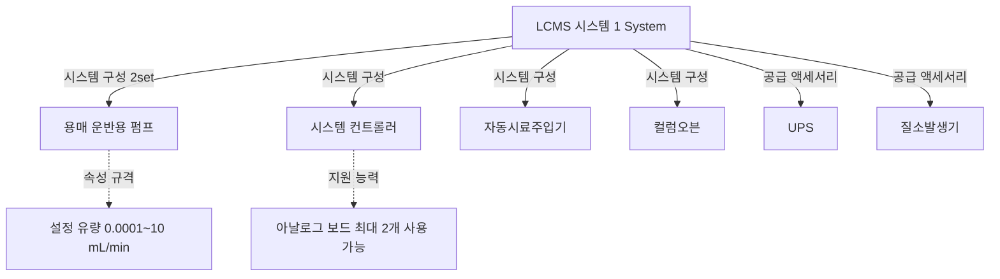
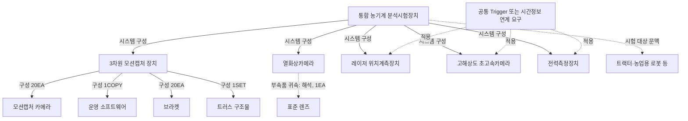
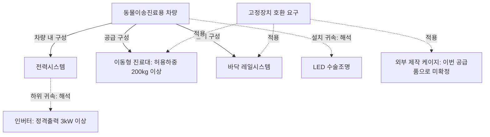

# 규격서 물품·분류·구성·속성 모델

상태: 2026-10-27 `goods` 1.0.0 Draft 보완. 작성 입력은
[goods.yaml](../../backend/authoring/ontology_blueprints/goods.yaml)이다.
객체 17개·속성 93개·관계 50개를 정의한다. Published 모델, 사전 데이터 적재,
추출기 적용, 조회 Capability의 완료를 의미하지 않는다.
실제 Draft 반영과 검사 결과는 [검증 기록](../verification/goods_model_revision_2026_10_27.md)에 둔다.


후속 검토: 서버 외 기존 샘플 4개를 대조한 결과는 아래 **샘플 4개 기반 재제안**에 기록했다.
재제안 이후 납품 범위·문맥·연계와 구조화 값 계약을 Draft에 반영했다. 아래 **네 샘플의 구성 관계 예시와 구현 상태**가 현재 상태다.

## 목적과 소유권

규격서가 기술하는 물품의 종류·분류·구성·특성·조건과 근거를 연결한다.
구성 탐색·표준화·검토·변경 확인·검색·비교·AI 질의가 이를 활용한다.
`goods`가 의미의 게시 경계이며 분류 코드마다 namespace를 생성하지 않는다.
작성과 검토는 `semantic_modeling`, 후보·프로파일은 `goods_normalization`,
문서 추출·정규화는 `specification_processing`이 소유한다.

Application DB는 Ontology 정의·프로파일·제안·검토 이력을 소유한다.
문서별 인스턴스 조회 데이터·실행 상태는 Data DB, 큰 본문·원문은 파일/S3에 둔다.
사전 객체를 선언한 것이 사전 저장 API나 승인 기능의 구현을 뜻하지 않는다.
사전 판본·작성 데이터의 적재·승인 계약은 후속 구현 대상이다.
OpenMetadata의 기술·거버넌스 metadata를 복제하지 않는다.

## 공식 자료와 적용 판단

아래 적용 내용은 Teoria의 설계 판단이다. 외부 표준 전체의 도입·준수 인증을 뜻하지 않는다.

| 공식 자료 | 확인한 내용 | 적용 |
|---|---|---|
| [조달청 분류체계 안내](https://www.pps.go.kr/kor/bbs/view.do?bbsSn=2110060011&key=00641) | 대·중·소·세 각 2자리의 물품분류번호와 추가 2자리의 세부품명 | 체계·판본·단계와 출처를 명시하고 물품식별번호와 구별 |
| [ECLASS 제품 구성](https://eclass.eu/support/guides/guides-for-expert-groups/composition-of-items) | 제품과 구성품의 개별 기술, 구성 목록과 연결 관계, 구성품 자체의 재귀적 구성 | 동일 물품 항목을 구성 관계로 연결하고 문맥상 구성품 역할 부여 |
| [ECLASS Basic·Advanced](https://eclass.eu/en/eclass-standard/basic-advanced) | 분류와 구조화된 특성·반복 블록·문맥 | 유형별 적용 특성과 문서의 실제 특성 진술 분리 |
| [Palantir 구조 지침](https://www.palantir.com/docs/foundry/ontology/ontology-structural-guidance) | 자체 metadata가 있는 관계는 연결 객체로 표현 | 구성 수량·선택·범위·근거를 구성 명세에 보존 |
| [Palantir 설계 원칙](https://www.palantir.com/docs/foundry/ontology/ontology-best-practices) | 업무 실체를 모델링하고 업무 질문으로 검증 | 물품·서비스·규격 요구를 구별하고 원문 사례로 탐색 확인 |
| [QUDT](https://www.qudt.org/pages/QUDToverviewPage.html) | 수량 종류·값·단위 구별 | 속성 의미·적용 범위·단위를 확인한 후에만 수치 해석 |
| [W3C 다항 관계 패턴](https://www.w3.org/TR/swbp-n-aryRelations/) | 관계의 추가 정보를 관계 개체로 표현하는 패턴 | 상위·하위 물품 외에 수량·조건·근거를 함께 연결 |
| [W3C SKOS](https://www.w3.org/TR/skos-reference/) | 분류·용어 체계와 개념 간 의미 관계 | 분류 계층과 물품 구성·유형 관계에 별도 의미 부여 |

## 모델 목록

| 객체 | 의미와 식별 |
|---|---|
| `classification_scheme` | 관리기관의 분류체계 판본. `scheme_id + edition` |
| `classification_entry` | 그 판본의 공식 분류항목. `scheme_id + edition + code` |
| `classification_assignment` | 특정 물품 항목에 대한 출처별 분류 주장과 검증 상태 |
| `item_type` | 서버·메모리 등 업무 유형 정의 사전의 항목 |
| `characteristic_definition` | 표준 특성의 뜻·값 종류·수량 종류·허용 단위 정의 |
| `specification_document` | 특정 원본 버전의 규격서. `document_id + revision_id` |
| `specified_item` | 문서가 지시하는 물품·구성 대상. 제조사 모델·실물 자산과 구별 |
| `composition_statement` | 상위·하위 물품 사이의 구성·수량·포함·적용 범위 진술 |
| `property_statement` | 대상의 특성에 관한 원문 값·조건과 해석한 값 |
| `specified_service` | 문서가 요구하는 설정·설치·연동시험 등 서비스 항목 |
| `requirement_statement` | 속성 하나로 축약하기 어려운 의무·조건 |
| `evidence` | 특정 문서 버전의 인용 구절과 위치 |

`item_type`과 `characteristic_definition`은 업무 사전의 **항목**을 나타낸다.
Ontology native Object/Property를 복사해 보관하는 메타모델이 아니다.
native Property는 이 객체들의 고정 필드·자료형을 정의하고, 사전은 물품별 다양한
특성의 업무 정의와 적용 가능성을 기술한다. 개별 명세는 관계로 해당 사전 항목을 참조한다.
사전 행 ID와 Ontology schema의 Stable Concept ID는 서로 다른 식별자다.
외부 사전와의 동등성은 이름이나 코드 접두사로 확정하지 않는다.

## 분류 계층과 출처별 판정

조달 분류는 대분류 → 중분류 → 소분류 → 세분류 → 세부품명으로 탐색한다.
코드는 문자열로 보존한다. 분류항목의 직접 상위 관계는 공식 판본을 대조한다.
코드 앞부분을 자르는 것만으로 실제 분류항목·명칭·상위 관계를 생성하지 않는다.
다른 분류체계나 판본 사이의 상위 연결, 자기 참조와 순환을 허용하지 않는 것이 인스턴스 계약의 요구사항이다.
현재 schema 검증이 이 인스턴스 정책을 실행하는 것은 아니다.

`classification_assignment`는 원문 코드·표제·출처·검증 상태를 보존한다.
공식 분류와 대응이 확인된 경우만 `resolved_classification`을 연결한다.
미해결·충돌 상태에서는 연결을 생략할 수 있다. 서로 다른 출처의 주장을 덮어쓰지 않는다.
공고 검색의 분류 필터는 해당 문서의 모든 물품·구성품의 분류 증거가 아니다.
주 물품의 분류를 CPU·메모리·GPU에 전파하지 않는다.
8자리 물품분류번호, 10자리 세부품명번호, 개별 품목의 물품식별번호,
문서의 품목 행 번호를 각각 구별한다. 길이만으로 코드 종류를 확정하지 않는다.

## 물품과 구성품의 연결

구성품도 `specified_item`이다. 단독 구매에서는 주 물품이 될 수 있으며
하위 구성품을 가질 수도 있다. 메모리라는 이름으로 여러 서버의 항목을 합치지 않는다.



구성 명세마다 상위·하위 물품은 각각 하나다. GPU 2개라는 요구는 GPU 항목 하나와 수량 2로
표현할 수 있으며 일련번호가 있는 두 실물을 만들어내지 않는다. 수량 조건과 단위·적용 범위를 함께 보존한다.
물리 구성, 공급 범위, 부속품, 호환·지원, 연결의 의미를 `relation_kind`로 구별한다.
필수·선택·제외·참고를 `inclusion_role`로 구별한다.
수량 범위나 논리 조건을 단일 수치로 축약하지 않으며 해석한 단일 수치가 있을 때만 `quantity_value`를 둔다.

단순 `has_component` 탐색은 후속 Runtime에서 명시적·채택된 물리 구성 관계를 투영해 제공한다.
현재 Draft에 직접 링크를 추가해 제외·호환 관계까지 부품으로 보이게 하지 않는다.
새 문서 그래프 계약은 자기 포함·구성 순환·해당 그래프에 없는 대상 참조를 차단한다.
공식 분류 사전의 판본·계층 검증은 별도 후속 연결 대상이다.
구성 경로의 하위 탐색이 모든 관계의 자동 전이·수량 곱셈을 허용하는 것은 아니다.
문서 목차의 부모·자식으로 물리 구성을 추정하지 않는다.

## 특성과 서비스

물품 유형에서 `applicable_characteristic`으로 적용 가능한 표준 특성을 탐색한다.
적용 가능하다는 사실이 개별 문서에 값이 존재하거나 필수 요구라는 뜻은 아니다.
속성 명세는 대상·표준 특성·값 종류·원문 값·연산·단위·전체/개별 범위·역할·근거를 연결한다.
단일 수치 조건만 `numeric_value`로 해석하고 범위·집합·복합 조건은 원문을 유지한다.
GB를 근거 없이 GiB로 바꾸지 않으며 명시하지 않은 합계를 계산해 원문 값으로 만들지 않는다.
시스템 메모리와 GPU 메모리, 소비전력과 정격출력처럼 단위가 같아도 의미가 다르면 구별한다.
반복 진술·상충 값은 근거를 유지하고 확인 전에는 합치거나 덮어쓰지 않는다.

설정·연동시험 등은 `specified_service`로 표현하고 `service_subject`로 대상 물품을 연결한다.
서비스 의무·조건은 `service_requirement`, 원문 근거는 `service_evidence`로 연결한다.
Linux 같은 소프트웨어 제품은 물품 유형으로 표현할 수 있지만 설치·설정 작업과는 구별한다.
업무 활동이 실제 실행됐다는 사실이나 이미 설치된 자산의 존재는 구매 요구에서 추론하지 않는다.

## 실제 규격서 대조 사례

원본은 로컬 평가 corpus의 공고별 `original.pdf`이며 아래 내용은 수동으로 원문을 확인한 설계 사례다.
재추출·사전 적재·문서 인스턴스 게시를 완료했다는 뜻은 아니다.

| 원문 | 보존할 해석 |
|---|---|
| `R26BK01781846`, 1쪽: 정부물품분류번호(8자리), 값 `4321150102` | 원문 표제와 10자리 코드의 불일치를 보존. 공식 판본 확인 전 자동 확정 금지 |
| 같은 문서: Computation Node 2식, HPCC Environment Driver 1식 | 구매 묶음·장비 구성과 소프트웨어·구축 작업 구별. 목차를 물리 구성으로 바꾸지 않음 |
| 같은 문서: RAM 2 x 16GB DDR5-4800 RDIMM, 32 DIMM 슬롯 보유 | 모듈 수·개별 용량·슬롯 수를 구별. 슬롯 32개를 메모리 32개로 처리하지 않음 |
| `R26BK01771789`, 1쪽: `43211502 (컴퓨터 서버)` | 원문 8자리 코드 주장을 보존. 다른 문서나 수집 필터의 10자리 코드로 대체하지 않음 |
| 같은 문서: S02~S08은 서버 1대에 포함되는 구성품 | 명시적 구성 근거로 상위 서버 연결. S09까지 구성품으로 확장하지 않음 |
| 같은 문서: DDR5 총512GB 이상 / 개별 메모리141GB 이상 GPU 2개 이상 | 시스템 메모리 전체 요구와 GPU 개별 메모리 요구의 대상·범위·수량 연산 구별 |
| 같은 문서: MAK 설정·실제 연동시험 S09 | 서비스 항목 및 적용 대상·조건·근거로 연결 |

이 예시는 서버 자료다. 다른 물품군의 원문 검증 전 전체 조달 물품에 대한 일반성을 확정하지 않는다.

## 승인과 다음 구현 경계

현재 Draft schema는 인증된 Admin API로 수정하고, 승인·게시 전 Runtime artifact에 포함하지 않는다.
AI 결과는 제안이며 `review_ref` 문자열이나 사전 행 생성이 승인 자체를 대신하지 않는다.
기존 Binding/프로파일 제안·검토·승인 이력을 재사용하고 요청 body의 actor를 신뢰하지 않는다.
Pipeline의 의미 작성은 인증된 Admin HTTP API를 사용하며 Capability/Runtime을 직접 호출하지 않는다.

후속 구현은 다음 순서다.

1. 분류 판본·사전 데이터·문서 명세의 인스턴스 계약과 승인·적재 경계를 확정한다.
2. 공식 분류 사전을 대조하고 물품 유형·표준 특성의 실제 항목을 근거와 함께 작성·검토한다.
3. 인스턴스의 참조·판본·순환·단위·대상·검토 상태를 검사한다.
4. 새 의미를 승인·게시한 뒤 프로파일·추출·조회 Mapping을 연결한다.
5. 원문별 물품·구성품·특성·서비스·분류 주장·근거를 탐색하는 Runtime을 검증한다.

작성 입력의 materialization·schema 정합성과 새 문서 그래프 계약의 구조·참조 검증을 수행한다.
새 추출 결과·실데이터 적재·Runtime 연결이 운영에서 검증됐다는 뜻으로 기록하지 않는다.


## 샘플 4개 기반 재제안 — 2026-10-27

### 분석 대상·방법·분류 전제

대상은 `.artifacts/sample`의 기존 원본 4개다. 서버 원문 네 개와 구별한다.
원본을 변경하지 않고 배포된 Parser 0.9.15로 다시 읽었다. 네 파일 모두 원본 해시를 대조했다.
문단·중첩 표 전체를 읽고, 액체크로마토그래프 PDF의 관련 페이지와 환경감시 HWP의 내장 이미지도 확인했다.
환경감시 기능표 2개는 직접 시각적으로 확인했다. 농기계 HWPX 내장 이미지는 기관 로고였다.
HWP/HWPX의 parser page_count 1은 section 기반 값이므로 실제 1쪽짜리 문서라고 기록하지 않는다.
파싱 성공을 그림·레이아웃·기능표의 완전한 추출로 간주하지 않는다.

[근거 목록](examples/goods_four_sample_evidence.yaml)에 원본명·SHA-256·native_ref·인용을 보존했다.
텍스트 인용 46건은 각 원본 파싱 노드의 부분문자열과 대조했다. 이미지 기능표 2건의 관찰은 별도로 표시했다.
이는 분석을 위한 수동 선정 근거이며, 전체 엔티티 추출 결과·사람 승인 정답·정확도 평가 결과가 아니다.
기존 평가기 보정용 silver 사례를 새로운 독립 정답으로 재사용하지 않았다.

사용자가 제공하지 않은 **외부 분류 metadata는 네 샘플 모두 없음**으로 취급한다.
일부 본문 표에는 분류 코드가 적혀 있다. LCMS 문서의 `41115404`, 농기계 문서의 `4111161501`은
원문 코드 주장으로만 보존한다. 공식 사전 검증·실데이터 항목과의 매칭을 완료한 것으로 취급하지 않는다.
특수차량의 본문 분류 칸은 비어 있다. 장비명으로 세부품명번호를 추측하지 않는다.

### 1. 환경감시·제어 모니터링 장치

**원문 구조:** 공급 목록에는 센서 및 분석장치 8식, 데이터 전송장치 8식,
운용프로그램 업그레이드 1식, 센서 교체·설치공사 1식이 있다.
기술시방은 환경가스 측정장치, 유해가스 측정장치, 데이터 전송장치, 운용·모니터링 프로그램,
교체·설치 작업으로 나뉜다. 설치구역은 4곳이며 각 1set으로 기재한다.

**의미 구조:** 이 구매는 기존 시스템의 교체·확장과 프로그램 개선을 포함한다.
공급 목록 전체를 새로 만드는 물리 장비 한 대의 BOM으로 해석하면 안 된다.
현재 운용 중인 데이터 전송장치와 새 공급 장치의 동일성·수량 배분은 추가 확인 대상이다.
센서 8식과 설치구역 4곳을 근거 없이 나눠 구역당 센서 2식으로 확정하지 않는다.

- CO/H2S/O2/EX, SO2/HBR은 측정 대상·채널을 나타내는 원문 표현이다. 가스 자체를 납품 부품으로 생성하지 않는다.
- 센서 → 데이터 전송장치 → 모니터링 프로그램의 데이터 연계는 물리 포함과 구분한다.
- 프로그램 업그레이드는 작업, 프로그램은 소프트웨어 대상이다. 서로 연결하되 하나의 물품으로 합치지 않는다.
- 내장 Data Function·Transaction Function 표의 가스 모니터링·공조 제어·경보·이력 관리는 기능 요구다.
  표 안의 ‘센서 마스터 관리’나 ‘테이블명’을 실제 운영 DB의 Technical Metadata로 승격하지 않는다.
- 보증 1년의 시작은 시운전 완료이며 수리 후 기간 조건도 있다. 기간 숫자만 추출하지 않는다.

근거: `s1_supply_sensor`, `s1_upgrade`, `s1_install`, `s1_gas_targets`,
`s1_gas_link`, `s1_existing_device`, `s1_installation_areas`, `s1_warranty_trigger`와 내장 기능표.

### 2. 액체크로마토그래프 질량분석기

**원문 구조:** 1 System의 질량분석기, 시스템 컨트롤러, 펌프 2set,
자동시료주입기, 컬럼오븐, 검출기, 가스제거 유닛, 데이터 처리 시스템과 액세서리를 기술한다.
데이터 처리 시스템에는 소프트웨어 기능과 PC 사양이 있으며,
액세서리에는 N2 generator·UPS·폐액보관함·소모품 등이 있다.

**의미 구조:** 시스템 공급 구성과 내부 부품, 주변 장치, 소모품을 구별한다.
UPS와 N2 generator가 공급 목록에 있다고 LCMS 본체 내부에 장착된 부품으로 단정하지 않는다.
‘컨트롤러 연결가능 유닛 수 8’, ‘아날로그 보드 최대 2개 사용가능’도 실제 납품 수량이 아니다.

- 펌프 유량 설정 범위 `0.0001~10 mL/min`은 단일 값 대신 범위다.
- 주입량 정확도는 `≤ ±1% (5μL injection, n=20)`로 시험 조건을 동반한다.
- 재현성은 주입량 구간별 RSD 조건이 달라 한 개의 수치로 압축하면 의미가 손실된다.
- 컬럼오븐의 `상온-10℃ ~ 100℃`는 환경 온도를 참조하는 상대 경계다. 하한을 -10℃로 고정하지 않는다.
- `250 mm 컬럼 6개 또는 300 mm 컬럼 3개`는 수용 능력의 대안이다. 두 종류 컬럼이 모두 공급된다는 뜻이 아니다.
- 펌프 2set은 동일 규격 항목과 구성 수량으로 표현할 수 있다. 실물 두 대의 자산 ID를 만들지 않는다.

근거: `s2_pump_supply`, `s2_pump_quantity`, `s2_flow_range`, `s2_sample_condition`,
`s2_conditional_precision`, `s2_ambient_relative`, `s2_capacity_alternative`,
`s2_optional_capacity`, `s2_accessory_nitrogen`, `s2_accessory_ups`.

### 3. 지능형 농기계 정적상태·주행성능 분석시험장치

**원문 구조:** 레이저 위치계측, 두 종류 초고속카메라, 보행자 더미,
전력측정, 모션캡처, 열화상, 음향, 전자파측정 등의 장비를 연계한 통합 시험장치다.
개별 장비는 독립 운용이 가능하지만 공급은 전체 시험목적·연계를 고려한 통합 구성을 요구한다.
모션캡처 구성에는 카메라 20EA·소프트웨어 1COPY·브라켓 20EA·트러스 1SET이 있다.

**의미 구조:** 물리 부품 트리만으로는 통합 시험장치를 설명할 수 없다.
물리적 장착, 통합 시스템 구성, 공급 묶음, 시간 동기화·데이터 연계를 구별해야 한다.
트랙터·농업용 로봇은 시험 대상이고, 그 배터리·인버터·모터는 측정 대상이다.
이를 시험장치의 납품 구성품으로 넣지 않는다. 반면 반사체·보행자 Target은 명시적인 공급 구성이다.

- ‘열화상카메라, 표준 렌즈, 기타 부속품’은 구성 목록의 근거다. 이 문장만으로 렌즈의 장착 방식까지 확정하지 않는다.
- 열화상카메라의 최대 측정온도 `+1,000℃ 이상`은 측정 능력의 상한 요구다. 주변 운용온도나 측정한 농기계 온도가 아니다.
- `2,048×1,152 pixels`와 최대 `100,000 fps`가 각각 요구되지만, 두 최대 성능이 동시에 가능하다고 추정하지 않는다.
- 위치 정확도 `±15 μm + 6 μm/m급 이하`는 거리 의존 표현이다. 15 μm라는 단일 오차로 축약하지 않는다.
- 공통 Trigger 또는 시간정보 연계는 복수 장비에 걸친 기능 요구다. 모든 장비 쌍에 동일 동기화 링크를 임의로 생성하지 않는다.
- SAT 검수표의 `100 Hz 이상`과 상세 위치계측 요구는 각각의 원문 위치와 역할을 유지한 뒤 검증 관계로 연결할 수 있다.
- ISO 19206-2 또는 동등 이상 요건은 참조 표준·대안 조건이다. 이름 유사성으로 동등 표준을 자동 승인하지 않는다.

근거: `s3_test_subject`, `s3_integrated_delivery`, `s3_synchronization`, `s3_formula`,
`s3_motion_components`, `s3_thermal_range`, `s3_thermal_components`, `s3_measurement_target`,
`s3_resolution`, `s3_max_fps`, `s3_standard`, `s3_acceptance`, `s3_acceptance_sequence`.

### 4. 동물이송진료용 특수차량

**원문 구조:** 완성 특수차량 1set을 기반 차량, 내부 구획, 진료 공간,
수납 시스템·수술조명·진료대·레일·전력시스템·외부전원 연결장치·고정장치·마감 요구로 기술한다.
표의 ‘편의사항’, ‘내부 마감’은 그대로 독립 구매 물품으로 생성할 대상이 아니다.
진료공간은 부품 목록과 다른 공간·기능상의 대상이다.

**의미 구조:** 차량 → 전력시스템 → 인버터라는 하위 구조는 유효하다.
그와 함께 공급할 진료대, 외부에서 별도 제작하는 케이지, 고정 대상으로 언급된 의료장비,
공간·설치 위치·호환 조건을 표현해야 한다.

- 진료대는 차량 구성품으로 포함한다고 명시한다. 허용하중 `200kg 이상`의 대상은 진료대다.
- 이동형 케이지는 발주처에서 별도 제작한다. 이번 차량 공급품으로 확정하지 않으며, 케이지 치수는 고정·적재 설계의 입력이다.
- X-ray·초음파·마취기·환자감시장치의 언급은 장비 고정 요구의 문맥이다. 해당 장비의 납품까지 주장하지 않는다.
- 레일은 진료대·케이지 고정장치와 호환되어야 한다. 호환 관계와 물리 구성 관계를 구별한다.
- 인버터 정격출력 `3kW 이상`, 콘센트 `220V AC`·`2개소 이상`을 서로 다른 대상과 조건에 귀속한다.
- 수술조명 `100,000 lux 이상`의 기준은 작업면이다. 램프의 추상적인 광량 값으로 바꾸지 않는다.
- ‘현대 쏠라티 또는 동급’은 기준 모델·대안 요구다. 제조사·모델을 확정한 제품 인스턴스로 만들지 않는다.
- 특장장치 보증 2년의 시작은 차량등록일이다. 다른 문서의 시운전 완료 기준과 구별한다.

근거: `s4_equivalent_model`, `s4_external_cage`, `s4_table_included`, `s4_table_load`,
`s4_table_height`, `s4_rail_compatibility`, `s4_inverter`, `s4_power_outlets`,
`s4_medical_reference`, `s4_workplane_illuminance`, `s4_registration_warranty`.

### 현재 Draft에서 유지할 것과 바꿀 것

물품을 같은 종류의 항목으로 표현하고 구성품 역할을 관계에서 부여하는 원칙,
문서 요구와 실제 제품·자산의 구분, 원문 근거·분류 출처의 보존은 유지한다.
12개 객체라는 현재 목록 자체를 최종 설계로 고정하지 않는다.

| 현재 표현의 한계 | 샘플에서 드러난 문제 | 재제안 |
|---|---|---|
| 문서 → 물품만으로 전체를 기술 | 기존 시스템 개선·복수 장비와 작업의 구매 묶음 | 납품 범위/구매 구성을 식별하고 물품·서비스·납품자료를 연결. 물리 장비 한 대로 간주하지 않음 |
| 항목의 공급 역할이 명시적이지 않음 | 시험 대상 농기계·별도 제작 케이지·고정 대상 의료장비 | 납품 요구·기존 설비·외부 제공·시험 대상·참고·미해결을 문맥별로 구별 |
| 구성 명세에 호환·연결까지 혼재 | 전송·동기화·호환과 내부 구성이 섞임 | 관계 명세를 의미별로 분리하고 방향·대상 종류·원문 조건을 검증 |
| 단일 numeric_value와 문자열 qualifiers 중심 | 범위·오차·구간별 조건·대안·상대 온도·거리 의존식 | 자료형별 값과 구조화된 조건식 계약. 해석이 불확실한 식은 원문과 보류 상태 유지 |
| 기타 요구가 자유 텍스트 중심 | 가스 모니터링·시험 이벤트 연계·검수 기준·보증 기산점 | 기능·연계·서비스·표준 준수·검수 요구를 구분하고 적용 대상·조건·시점·근거를 연결 |
| 요구 대상이 물품 위주 | 공간·복수 장비·서비스·납품 묶음에 대한 요구 | 문서 내 물품 외에도 실제 식별이 필요한 공간·기능 묶음·서비스·납품 범위로 적용 대상을 확장 |
| 분류별 프로파일을 전제 | 샘플에는 외부 분류 metadata 없음 | 분류 없이 기본 분석 가능. 검증한 실데이터의 분류·유형·명시 선택으로 특화 규칙 적용 |

### 권장하는 개념 구조

아래는 후속 수정안이며 현재 Runtime에 존재하는 타입·인터페이스의 구현 목록이 아니다.



**납품 구성과 대상:** 물품·소프트웨어·서비스·필수 제출자료를 구매 문맥에서 연결한다.
구매 항목의 역할은 고정 분류 타입과 구별한다. 필요할 때만 공간·설치 구역·참고 모델 등
업무상 정체성이 있는 대상을 식별한다. 모든 명사·목차·가스명·법령명을 별도 객체로 만들지 않는다.

**관계:** 물리 구성, 통합 시스템 구성, 공급 포함, 부속품, 설치·장착,
호환, 데이터·전원 연결을 구별한다. 구성 관계마다 수량·원문 수량 단위·전체/개별 범위·필수/선택·해석 근거를 보존한다.
의미가 명확한 직접 관계를 탐색 화면에 노출하되 상세 관계 명세와 근거로 되돌아갈 수 있게 한다.
상위 물품의 요구가 모든 하위 부품에 자동 상속된다고 가정하지 않는다.
동기화처럼 복수 대상의 공동 조건은 하나의 요구에 여러 대상을 연결한다.

**속성과 요구:** 표준 특성 정의와 그 문서의 규격 조건을 구분한다.
값 계약에는 단일 수치·구간·허용오차·차원별 값·열거·문자·참조와 ALL/ANY·조건 분기를 포함한다.
상온 참조·거리 의존식은 문맥 참조를 보존한다. 실제 계산·판정을 지원할 표현만 구조화하고,
해석하지 못한 원문을 억지로 실행식으로 만들지 않는다.
기능 요구의 ‘기능’은 물품이 수행해야 할 기능이며 Teoria Runtime의 Capability와 구별한다.
검수 기준은 검증할 속성·기능 요구와 연결하고 실제 검사 결과와 구별한다.
표준 참조는 식별자·원문 판본·조항·동등 대안 여부를 필요한 만큼 표현한다.

**분류와 유형:** 물품 유형·특성 사전과 대·중·소·세·세부품명 계층을 유지한다.
외부 분류를 필수 입력으로 요구하지 않고, 실데이터에서 연결할 수 있을 때 추가한다.
실데이터의 분류 주체가 공고·구매 품목·등록 제품 중 무엇인지 확인하고, 같은 식별 근거로 연결되는 대상에만 붙인다.
항목 분류가 없어도 문서의 항목·구성·속성·근거를 분석·검토할 수 있어야 한다.
기존 `NormalizationProfile.classification_code`는 10자리 필수여서 이 방향과 맞지 않는다.
후속 구현에서 분류와 독립적인 기본 처리와 검증한 문맥에 따른 특화 규칙 선택을 분리해야 한다.
이번 분석에서 이 계약을 변경하거나 불명확한 분류로 기존 계약 검증을 우회하지 않았다.

### 구현 전에 고정할 수용 사례

1. 환경감시 공급 구성에서 센서·전송장치·프로그램·업그레이드·설치 작업을 구별하고 가스를 부품으로 만들지 않는다.
2. 환경감시 이미지 기능표의 내용이 있다는 것을 표시하고 분석하지 못한 그림을 누락 없이 검토 대상으로 남긴다.
3. LCMS 펌프 2set과 컨트롤러 지원 유닛 8개를 서로 다른 수량 역할로 표현한다.
4. LCMS의 조건별 재현성·상대 온도·대안적 컬럼 수용 능력을 원문 조건과 함께 보존한다.
5. 농기계 시험장치의 구매 장비·시험 대상·반사체/더미·공동 데이터 연계 요구를 구별한다.
6. 농기계 문서의 해상도와 최대 fps가 동시 성능이라는 주장을 생성하지 않는다.
7. 특수차량 진료대를 공급 구성으로, 별도 제작 케이지와 언급 의료장비를 외부 대상/미확정 공급으로 표현한다.
8. 진료대 하중·인버터 출력·작업면 조도를 정확한 대상과 측정 문맥에 귀속한다.
9. 네 샘플의 외부 분류 metadata를 비워 둔 상태로 위 구조를 표현하고, 실제 분류정보가 추가돼도 항목 ID와 구성 관계를 재작성하지 않는다.
10. 원문·해석·검토·게시·실제 납품/시험 사실을 구분하고 분류·포함 관계의 자기 참조·순환·잘못된 문서 연결을 검사한다.

검토 순서는 이 원문 사례의 대표 그래프를 먼저 확정하고, 그 그래프를 표현하는 명세 계약을 검증한 다음
Draft를 수정하는 것이다. 현재 운영 Draft를 다시 삭제·확장하거나 사전·원문 인스턴스를 게시하지 않았다.


## 네 샘플의 구성 관계 예시와 구현 상태

아래는 원문을 읽고 사람이 확인할 수 있도록 작성한 **제안 상태의 대표 그래프**다.
전체 추출 결과나 승인된 실물 BOM이 아니다. 모든 장비와 연결은 문서의 요구를 표현한다.
실선은 원문에 명시된 구성·공급 요구, 점선에 ‘해석’ 표시가 있는 구성은 문맥 해석이다.
점선으로 표시한 호환·데이터 연결·공동 요구·외부 대상은 물리 포함 관계와 구별한다.

작성 파일: [four_sample_graphs.yaml](../../backend/authoring/specification_examples/four_sample_graphs.yaml).
각 노드·구성·연계·속성·요구에는 원문 인용과 native_ref가 있다.
외부 분류 metadata는 제공되지 않아 네 그래프 모두 `classifications`가 비어 있다.
원문에 있는 분류 코드의 관찰은 앞 절과 별도 근거 목록에 보존하며, 그래프에 검증된 분류를 임의로 넣지 않았다.

### 환경감시 장치: 공급 구성과 데이터 연계



측정 대상 CO/H2S/O2/EX 등은 센서의 측정 특성·기능으로 표현하며 납품 구성품으로 만들지 않는다.
8식의 상세 장치별·설치 구역별 배분은 미확정이다. 기존 장치와 새 공급 장치도 동일 개체로 합치지 않았다.

### 액체크로마토그래프: 시스템 구성과 액세서리



‘시스템 구성’이 모든 장비의 본체 내부 장착을 의미하지 않는다. 보드 지원 수량으로 보드 2개를 공급품으로 생성하지 않는다.
원문의 다른 구성장비·액세서리는 이 대표 그래프에서 생략했으며 전체 공급 수량 집계로 사용하지 않는다.

### 농기계 시험장치: 재귀 구성과 공동 연계



표준 렌즈는 열화상 구성 목록에 명시돼 있지만 장착 방식은 미기재다. 카메라와의 부속품 귀속은 해석으로 표시했다.
트랙터·농업용 로봇이나 그 배터리·모터를 시험장치의 구성품으로 생성하지 않는다.
공동 연계 요구를 세 장비에 연결하며, 모든 장비 쌍에 동기화 사실을 자동 생성하지 않는다.

### 특수차량: 하위 구성과 외부 제작 케이지



호환 요구의 정확한 문구는 ‘진료대·케이지의 고정장치와 호환’이다.
위 그림의 적용 화살표는 요구의 대상 연결이며, 레일과 케이지가 물리 부품이라는 뜻이 아니다.
케이지와 진료대는 서로 다른 공급 역할을 가진다. 진료공간도 부품 대신 적용 문맥으로 표현한다.

### 구현과 실행 경계

- 작성 schema는 `goods` 1.0.0 Draft에 객체 17개·속성 93개·관계 50개로 반영했다.
- 물리 구성·시스템 구성·부속품은 기존 구성 명세를 사용하고 호환·설치·데이터·전원은 별도 물품 연계 명세로 구별했다.
- 납품 범위·범위별 역할·규격 적용 문맥·납품자료를 추가했다. 물품·서비스·문맥 등 대상 종류를 구별한다.
- 구조화 값·조건·요구 종류·기준 사건·표준 참조·검수 대상 관계를 추가했다.
- `goods_normalization/contracts/specification_graph.py`는 순수 검증 계약이다. 분류 없이 문서별 ID·근거·소속·구성 순환·대상 종류·값 형식·검수 참조를 검증한다.
- 이 계약의 `review_status`는 `proposed`다. 파일 생성·구조 검증이 승인·게시 또는 실제 납품·설치·시험 사실을 뜻하지 않는다.
- 새 그래프 계약의 검사는 분류 없이 실행된다. 기존 `NormalizationProfile`·기존 Flow의 분류 필수 계약은 호환을 위해 유지한다. 새 그래프의 자동 추출·프로파일·DB·Runtime 연결은 후속 구현이다.
- 제공되지 않은 분류값을 채우거나 평가 CLI의 분류 증거 검증을 우회하지 않았다.

```bash
uv run --project backend --locked --extra api teoria-pipelines specification validate-graph \
  --manifest backend/authoring/specification_examples/four_sample_graphs.yaml
```

이 명령은 읽기 전용이며 구조·참조 정합성만 검사한다. 원문 해석의 완전성·정확도, 외부 사전의 실재,
실제 공급·설치 여부를 보증하지 않는다. 일반 추출을 실행하거나 DB·Published Ontology를 변경하지 않는다.
