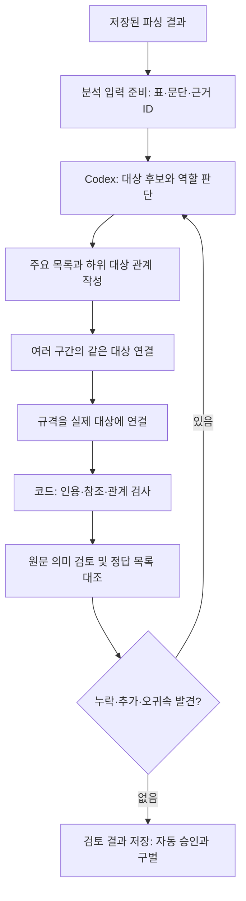

# 주요 구성품과 세부 규격 연결

구성품은 **문서에서 별도 규격을 제시하는 주요 장치·공간·시스템·소프트웨어·묶음**으로
찾는다. 물리적으로 분리되는 부품인지, 제목 바로 아래인지로만 결정하지 않는다.
주요 목록과 내부 부품의 관계는 따로 저장한다.

현재는 저장된 kordoc 결과를 받아 Codex가 분석하고 코드가 검사하는
**독립 오프라인 경로**다. 이전 품목·구성요소·요구조건·통합·사전 구축 모듈은
삭제했으며 이 문서가 현재 실행 기준이다. 사전 구축은 새 [초기 사전 구축 경로](dictionary_building_pipeline.md)에서
요구조건 관찰·의미 통합·초안·최종 검토·수정·로컬 승인을 조립한다.
이 구성 모듈 자체가 전체 조건을 자동 추출하는 것은 아니다. 운영 수집·DB·Registry에는 연결하지 않았다.

## 처리 순서



### 1. 원문에서 후보와 역할 찾기

공급 목록, 기술 규격, 부속품, 기타 조건, 후반 검수 표까지 함께 읽는다.
후보마다 다음을 구분한다.

| 역할 | 예시 | 주요 구성 목록에 포함 |
|---|---|---|
| 구매 완성품 | 완성 특수차량 | 전체를 나타내는 최상위 대상 |
| 주요 규격 단위 | 기본 차량, 수술공간, 진료대, 레일, 전력시스템 | 포함 |
| 세부 대상 | 수술조명, 인버터, 콘센트 | 소속 주요 단위 아래에 보존 |
| 외부 참조 | 발주처 별도 제작 케이지, 고정할 의료장비 | 납품 포함 근거 없이 추가하지 않음 |
| 시험 대상 | 시험에 사용하는 트랙터·농업용 로봇 | 납품 구성품으로 추가하지 않음 |
| 서비스·문서 그룹 | 설치 작업, 동적 주행시험 절 제목 | 장치와 구분 |

명시적인 장비 구성 목록이 있으면 출발점으로 삼는다. 단, 수량 오류 가능성,
서비스 혼입, 기술 규격과의 차이는 기록한다. 장 제목이나 표의 모든 행을 자동으로
구성품으로 변환하지 않는다. 명확한 근거가 없으면 주요 구성품이 없을 수도 있다.

### 2. 주요 목록과 하위 관계 정하기

주요 단위 선정 근거는 **기능·범위가 구별되고 독립적인 규격 설명이 있는가**다.
세부 부품이 별도 수치를 가진다는 이유만으로 모두 주요 목록에 올리지 않는다.
구성 목록·별도 규격 절·공급 범위를 대조하고, 경계가 모호하면 검토 대상으로 남긴다.
이 기준은 의미 판단이며 현재 키워드만으로 자동 판정하지 않는다.

차량은 다음처럼 표현한다.

```text
완성 특수차량
├ 차량: 기본 차종·크기·변속기
├ 응급처치 및 간이 수술공간
│ ├ 격벽·관찰창
│ ├ 수납·적재 시스템 → 작업면
│ ├ LED 수술조명
│ └ 산소통 거치대·의료장비 고정벨트
├ 대형동물 진료대
├ 바닥 레일 시스템
└ 전력시스템
  ├ 인버터
  ├ 콘센트
  └ 외부전원 연결장치
```

이 트리는 검토용 규격 묶음이다. 모두 물리적인 직접 포함 관계라는 뜻은 아니다.
외부전원과 고정장치의 묶음은 `interpreted`로 기록한다. 사용자가 다른 묶음을 선택해도
원문 인용과 세부 장치를 잃지 않고 주요 목록을 수정할 수 있다.

### 3. 떨어져 있는 설명 연결하기

이름이 같다는 이유만으로 합치지 않는다. 소유 단위, 기능, 납품·기보유 여부,
호환 대상과 주변 문맥을 대조한다.

- 차량 앞부분의 이동형 진료대와 뒤쪽 대형동물 진료대 규격은 같은 대상이라는 해석을 기록한다.
- 농기계 시험장치의 레이저 사양과 후반 SAT 표의 동적위치 계측 조건을 연결한다.
- 위치추적 Target과 보행자 Target은 역할이 달라 합치지 않는다.
- 같은 105MPa라도 펌프와 자동주입기는 서로 다른 소유 대상이다.

하나의 원문 셀에 여러 대상이 있으면 노드를 공유하되 인용 범위를 좁힌다.
여러 페이지·구간은 같은 대상의 `node_ids`에 비연속적으로 저장한다.

### 4. 규격을 실제 소유 대상에 연결하기

`인버터 정격출력 3kW 이상`은 전력시스템 내부 **인버터**에 연결한다.
`수술 작업면 조도 100,000lux 이상`은 **수술조명**에 연결한다.
주요 단위 화면에서는 아래 규격을 모아 보여주되 소유 대상을 바꾸지 않는다.

현재 `requirement_excerpts`는 원문 속성명·값·필수 여부·대상·근거의 대표 관찰이다.
전체 요구조건의 원자화, AND/OR, 단위 정규화, 표준 속성 사전 매핑까지 완료한 것은 아니다.
사전은 이 관계와 의미를 확인한 뒤 연결할 계획이다. 기존 서버 사전 52개는
과거 참고 결과로만 보존하며 현재 입력 사전으로 사용하지 않는다.

## 구현과 독립 실행

기준 구현은
[`composition_analysis.py`](../../pipelines/src/teoria_pipelines/domains/public_procurement/specification_intelligence/composition_analysis.py)다.
입출력 모델의 `model_json_schema()`를 계약으로 사용한다.

```bash
# 1. 정답을 넣지 않은 원문 분석 입력과 출력 스키마 생성
uv run --locked --package teoria-pipelines python -m \
  teoria_pipelines.domains.public_procurement.specification_intelligence.composition_analysis \
  prepare --native /path/to/native.json --document-id example \
  --output /path/to/context.json

# 2. Codex가 context를 읽어 proposal.json을 작성한 뒤 검사
uv run --locked --package teoria-pipelines python -m \
  teoria_pipelines.domains.public_procurement.specification_intelligence.composition_analysis \
  validate --native /path/to/native.json --proposal /path/to/proposal.json \
  --output /path/to/validation.json

# 3. 별도로 저장된 검토 목록과 대조
uv run --locked --package teoria-pipelines python -m \
  teoria_pipelines.domains.public_procurement.specification_intelligence.composition_analysis \
  evaluate --proposal /path/to/proposal.json --reference /path/to/reference.json \
  --output /path/to/evaluation.json
```

정답 JSON은 `documents: [{document_id, components: [이름, ...]}]` 형태다.
공백과 명시적인 수량·시험절 괄호 주석만 비교에서 정리한다. 모델명·유형 괄호는
유지하며 의미적 동의어를 코드가 자동 승인하지 않는다. 표현이 달라 불일치하면
원문 대조를 거쳐 평가 기준 또는 표현을 수정하고 기록한다.

각 명령은 기존 파일을 덮어쓰지 않는다. 구조 오류는 결과에 남기고 종료 코드 2를
반환한다. 의미를 작성하는 작업은 현재 대화형 Codex가 수행한다. 이 CLI 자체가
새 문서의 구성품을 자동 추출하거나 모델을 호출하지 않는다.

## 검사와 개선 기준

코드는 원문 해시·인용, 대상 ID, 부모 역할, 순환, 규격 소유자, 값의 원문 존재를 검사한다.
미배정 텍스트와 미확인 이미지도 출력한다. 검사 통과만으로 의미 정확성이나
구성품 누락이 없음을 보장하지 않는다. 의미 검토 상태는 항상 `pending`으로 남긴다.

구성품 누락은 목록 대조, 잘못된 이름은 의미 검토, 상위·하위의 오귀속은 원문과
소유 대상 대조로 확인한다. 이미지 미확인과 수량 모호성은 자동 해결하지 않는다.
모든 규격 구간의 소속·보류 사유가 정리되기 전에는 전체 규격 추출 완료로 표시하지 않는다.

수정은 새 revision으로 저장하고 이전 제안·검사 결과를 보존한다. 특정 표본의
품목명·정답 개수를 일반 추출 규칙으로 추가하지 않는다. 새 문서에서는 분석 입력에
정답을 넣지 않고, 결과를 먼저 저장한 뒤 독립 검토와 비교한다.

첫 네 표본의 실제 결과와 한계는 [검증 기록](verification/composition_review_2026_10_20.md)에 있다.
