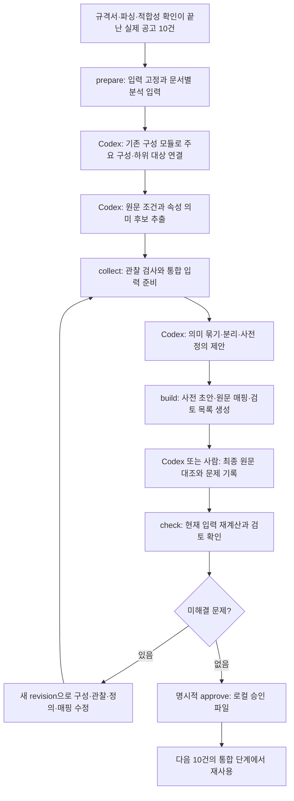

# 초기 속성사전 구축 파이프라인

구성 분석·근거·문서 적합성 모듈을 재사용하는 **별도 오프라인 파이프라인**이다.
기존 사전 없이 시작해 원문 관찰과 의미 후보를 모으고, 검토한 정의를 사전으로 만든다.
최종 검증에서 문제가 발견되면 수정·재검증한 뒤 로컬 승인 파일을 생성한다.

현재는 Codex가 분석·통합·최종 검토 JSON을 작성한다. 코드가 모델 API를 자동 호출하지
않는다. OCR·DB·Platform Runtime·운영 Flow·게시 사전에는 연결하지 않는다.
예전 구축 코드를 복원하지 않았으며 과거 사전 52개도 입력으로 사용하지 않는다.

[실제 서버 공고 10건의 실행 결과](verification/server_dictionary_bootstrap_2026_10_20.md)는
원문 관찰 385개·속성 정의 후보 152개다. 미해결 문제 19개가 남아 아직 승인하지 않았다.

## 전체 순서



1개 배치는 후보 10개가 아니라 서로 다른 공고 번호 10개다. 같은 원본·파싱 파일을
복제해 채우는 것도 거부한다. 10건씩 100건까지 점진 검토하는 목표를 유지한다.
같은 배치 수정과 새로운 10건 추가는 다르다. 수정은 이전 초안·검토 기록을 잇고,
다음 배치는 승인된 사전을 기준으로 새 문서를 처리한다.

## 모듈을 어떻게 재사용하는가

| 모듈 | 책임 |
|---|---|
| 기존 `document_evidence` | 구조·노드·인용 확인 |
| 기존 `document_qualification` | 저장된 적합성 판정을 현재 원문으로 재검증 |
| 기존 `composition_analysis` | 구성 계약·판단 지시문·주요/하위/외부 대상 관계 검사 |
| 새 `requirement_discovery` | 사전 ID 없는 속성 의미 후보·원문 조건·범위·논리·누락 검사 |
| 새 `dictionary_draft` | 유형·속성 정의 및 원문 매핑 검사와 사전 초안 조립 |
| 새 `dictionary_review` | 항목별 최종 검토·수정 이력·승인 가능 여부 |
| 새 `dictionary_bootstrap` | 파일 입출력과 위 모듈의 실행 순서·독립 CLI |

기준 진입점은
[`dictionary_bootstrap.py`](../../pipelines/src/teoria_pipelines/domains/public_procurement/specification_intelligence/dictionary_bootstrap.py)다.
도메인 계약은 각 모듈의 Pydantic 모델과 `model_json_schema()`를 따른다.
실행 순서와 의미 판단은 구별하며, 같은 작업 세션에서 제안하더라도 결과 파일은 나눈다.

## 처음 사전이 없으면

추출 단계에는 표준 속성 ID 필드가 없다. 예를 들어 `RAM 16GB 이상 장착`에서 다음을 저장한다.

| 구분 | 저장 예 |
|---|---|
| 실제 대상 | 특정 PC의 메모리 |
| 원문 속성·값·단위 | RAM / 16 / GB |
| 속성 의미 후보 | 실제 장착 메모리 합계 |
| 구분할 범위 | 전체 합계 / 장착 상태 / 시스템 메모리 |
| 조건·근거 | 이상 / 필수 / 문서·노드·정확 인용 |

`Memory 최대 128GB 지원`은 최대 지원 용량이라는 별도 의미 후보다.
두 조건을 원문 관찰로 먼저 보존하고 통합 단계에서 같은 의미끼리 묶는다.
사전에는 뜻·타입·단위·적용 유형·동의어를 넣고 공고의 16GB·128GB를 속성 정의로 복사하지 않는다.

관찰의 `kind`로 제품 속성과 소프트웨어·운영 작업을 구분한다. 작업 요구는 원문과
대상을 보존하고 사전 정의에서 제외한다. 부분적으로 읽은 셀은 `partially_observed`로
남기며 추출 관찰이 있어도 승인을 막는다. 문서의 모든 기술 조건을 읽었다는 판단은
Codex 또는 사람이 수행하며 코드의 노드 수 검사만으로 완전성을 보장하지 않는다.

## 입력 준비

`BatchRequest`에는 실제 10건의 `document_id`, `notice_number`와 다음 파일 경로·SHA-256이 필요하다.
경로는 절대 경로로 지정한다.

- 원본 파일: `source_path`, `source_sha256`
- kordoc native 결과: `native_path`, `native_sha256`
- 적합성 판정: `qualification_path`, `qualification_sha256`
- 파싱 실행 기록: `parse_record_path`, `parse_record_sha256`

실행 기록은 `document_id`, `parser=kordoc`, `version`, `status=success`,
`options.ocr=false`, `options.formulaOcr=false`를 가져야 한다. 문서별 기록 또는
문서 ID로 유일하게 찾을 수 있는 배열을 받는다. 실제 파서를 다시 실행하는 것은 아니며
보존된 기록을 확인한다. 판정의 source/native 해시와 근거도 재검증한다.

## 독립 실행

아래 예시는 실제 파일 경로로 바꿔 실행한다. 모든 출력은 새 경로를 사용한다.

```bash
# 1. 입력 고정. 원본·native·판정·파싱 기록을 스냅샷으로 보존
uv run --locked --package teoria-pipelines python -m   teoria_pipelines.domains.public_procurement.specification_intelligence.dictionary_bootstrap   prepare --request /path/to/batch_request.json --output-dir /path/to/prepared
```

`prepared/documents/<document_id>/context.json`을 Codex가 읽는다. 원문·구조·구성 및 추출
지시문·출력 스키마가 들어 있고 기존 사전은 없다. 구성 제안이 이미 있으면 재사용해
검사할 수 있다. 새 하위 대상이 필요하면 구성 제안부터 수정한다.

Codex가 문서별 `composition.json`과 `discovery.json`을 작성한 뒤
`analysis_request_template.json`에 실제 경로를 확인해 `analysis_request.json`으로 저장한다.
첫 배치의 `approved_base_path`는 null이다.

```bash
# 2. 의미 통합용 입력 준비
uv run --locked --package teoria-pipelines python -m   teoria_pipelines.domains.public_procurement.specification_intelligence.dictionary_bootstrap   collect --request /path/to/analysis_request.json --output-dir /path/to/collected

# 3. Codex가 collected/context.json을 읽고 consolidation.json 작성 후 초안 생성
uv run --locked --package teoria-pipelines python -m   teoria_pipelines.domains.public_procurement.specification_intelligence.dictionary_bootstrap   build --request /path/to/analysis_request.json --proposal /path/to/consolidation.json   --output-dir /path/to/draft_r1

# 4. Codex 또는 사람이 review_context.json과 원문을 확인해 final_review.json 작성
uv run --locked --package teoria-pipelines python -m   teoria_pipelines.domains.public_procurement.specification_intelligence.dictionary_bootstrap   check --draft-dir /path/to/draft_r1 --review /path/to/final_review_r1.json   --output /path/to/final_check_r1.json
```

검토할 때는 `attributes.csv`만 보지 않고 정의·매핑된 원문·대상 관계를 함께 확인한다.
`required_review_ids`의 관찰·속성·유형·문서 범위·논리·의미 중복 항목을 모두 검토한다.
실제 판단은 Codex 또는 사람이 수행한다. 코드가 읽지 않은 원문을 대신 의미 승인하지 않는다.

## 문제가 있으면 수정하고 다시 검증

문제는 최종 검토의 `findings`에 ID와 해당 검토 항목을 남긴다.
수정 제안에는 새 `revision`, `parent_draft_sha256`, `change_notes`를 기록한다.

```bash
uv run --locked --package teoria-pipelines python -m   teoria_pipelines.domains.public_procurement.specification_intelligence.dictionary_bootstrap   build --request /path/to/analysis_request_r2.json --proposal /path/to/consolidation_r2.json   --previous-draft-dir /path/to/draft_r1 --previous-review /path/to/final_review_r1.json   --output-dir /path/to/draft_r2
```

수정본에 대해 새 검토 파일을 작성하고 `check`를 다시 실행한다.
이전 문제 ID를 지우지 않고 해결 내용과 `resolved_in_revision`을 남긴다.
코드는 이전 지적사항이 사라지거나 미해결이면 승인을 막는다. 값·정의·매핑을 바꾸면
이전 초안 해시의 검토는 무효다. 승인 시에도 현재 원본 스냅샷·구성·추출·통합 입력에서
초안을 다시 계산해 확인한다. 결과 JSON에서 오류 목록만 지워 우회할 수 없다.

중복 정의를 삭제한 경우에도 그 정의를 대상으로 한 이전 지적사항의 검토 항목과
해결 기록은 유지한다. 삭제했다는 이유로 지적사항이 사라지면 안 된다.

입력 문서 자체를 바꾸는 것은 같은 초안의 수정이 아니다. 새 배치를 준비하고 처음부터 검토한다.

## 승인과 다음 배치

```bash
uv run --locked --package teoria-pipelines python -m   teoria_pipelines.domains.public_procurement.specification_intelligence.dictionary_bootstrap   approve --draft-dir /path/to/draft_r2 --review /path/to/final_review_r2.json   --reviewer reviewer_label --authorization-note '해당 파일 검토 후 로컬 승인'   --output /path/to/approved_dictionary.json
```

미해결 문제·검토 누락·해시 불일치가 있으면 거부한다. 승인 파일은 로컬
`offline_approved` 결과이며 Published Ontology나 Registry를 변경하지 않는다.
reviewer 문자열은 로컬 작업 기록이며 인증된 Admin principal을 뜻하지 않는다.

다음 배치의 `approved_base_path`에 이 파일을 지정한다. 기존 사전은 추출 이후
통합 단계에서만 읽는다. 이미 사용한 공고·원본을 다시 10건으로 세지 않는다.
기존 정의 재사용, 신규 유형·속성 추가, `alias_additions`를 통한 기존 정의의 동의어
추가를 지원한다. 동의어도 근거와 문맥을 검토하고 새 버전으로 저장하며 이전 파일은 바꾸지 않는다.
승인된 기존 정의의 의미 수정·병합·분할 이관은 v1 범위 밖이다.
그런 변경이 필요하면 보류하고 별도 버전 변경 계약을 먼저 정한다.

## 결과 파일

| 파일 | 내용 |
|---|---|
| `attributes.csv` | 속성명·정의·유형·단위·집계·구성 상태·측정 기준 |
| `draft.json` | 사전 초안·입력 해시·검사 문제·검토 항목 |
| `requirements.json` | 원문 관찰·표준 속성 연결·조건 그룹 |
| `review_context.json` | 최종 검토 지시문·스키마·필수 검토 항목 |
| `final_check*.json` | 승인 가능 여부와 차단 사유 |
| `approved_dictionary.json` | 명시적으로 승인한 로컬 사전 버전 |

단위 차원을 검사하지만 수치 단위 변환이나 제품 적합성 비교를 수행하지 않는다.
현재 지원 단위 밖의 조건, 해석 불명·이미지 미확인은 보류로 남겨 수정하도록 한다.
자동 문자열 검사와 명시적 의미 범위 검사는 의미 정확성의 충분조건이 아니다.

구현 검증은 [새 파이프라인 검증 기록](verification/dictionary_bootstrap_2026_10_20.md)을 본다.
이는 합성 계약 검증 기록이다. 실제 10건의 구축·미해결 문제는
[서버 실행 결과](verification/server_dictionary_bootstrap_2026_10_20.md)를 본다.
과거 52개 결과와 이전 코드 삭제 내역은 [정리 기록](verification/pipeline_cleanup_2026_10_20.md)에 있다.
