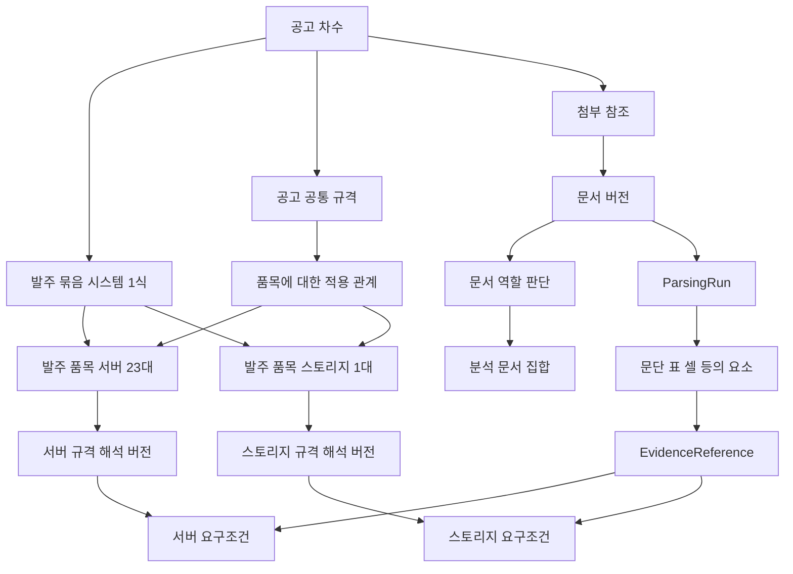

# 조달 규격 인텔리전스 도메인 모델 검토안

상태는 **1단계 검토 중**이다. 나라장터 일반 물품 규격서의 공고·품목·문서·구성요소·
요구조건·근거를 어떻게 구분하고 연결할지 제안한다. 특히 원문 조건이 모호하거나
속성 사전에 없을 때에도 정보를 보존할 수 있는 Requirement 구조를 결정한다.

서비스명은 **조달 규격 인텔리전스**다. 공고 첨부의 물품별 요구규격을 구조화해
검색·비교하고 제품 구성 평가·조달 관계 분석으로 확장한다. 아홉 단계의 서비스
처리 순서와 단계별 책임은 [전체 처리 경로](overview.md#3-전체-처리-경로)를
따른다. 아래 설계 검토 순서는 서비스 실행 단계 번호와 구분한다.

이 문서는 개념과 관계의 설계다. 코드, DB 테이블·migration, API와 JSON Schema는
정의하지 않는다. 사용자 검토 전에는 2단계 문서 파싱 설계로 진행하지 않는다.
첨부 처리 보류 정책과 현재 실행 기능도 변경하지 않는다.

[전체 설계 참고안](overview.md)은
장기 범위의 가설을 포함한다. 현재 검토의 기준은 이 문서이며 사용자 검토 결과에 따라
전체 참고안을 정리한다. 공통 경계는 [아키텍처](../architecture/overview.md),
[Ontology](../platform/ontology.md), [공식 분류 정책](../platform/domains/public_procurement/procurement_classification.md)을 따른다.

## 1 이번에 결정할 범위

검토할 질문은 다음 여섯 가지다.

1. 기존 공고 모델과 신규 규격 개념의 경계는 무엇인가.
2. 공고·발주 묶음·납품 품목·구성품의 관계를 어떻게 표현하는가.
3. 품목 분류, 구성요소 유형, 규격 안의 구성요소 대상을 어떻게 구분하는가.
4. 요구조건의 원문·해석·적용 범위·논리·불확실성을 어떻게 보존하는가.
5. 실제 서버 문장과 다품목 반례를 손실 없이 표현할 수 있는가.
6. 여러 첨부 중 어떤 문서가 규격·품목·공통 조건의 근거인지 어떻게 판단하고 기록하는가.

문서 파싱은 독립적인 다음 설계 단계다. 여기서는 원본 버전·파싱 실행·문서 요소·
근거 참조의 개념과 관계만 정의한다. 파서 선택, 표 좌표 계약, 정규화 JSON과 오류
처리 상세는 2단계에서 검토한다.

## 2 개념과 Object 경계

아래 개념은 도메인을 이해하기 위한 모델이다. 모두를 새로운 Business Ontology
Object Type이나 영속 테이블로 만들겠다는 뜻은 아니다. 파싱 실행·문서 블록·LLM
출력은 처리 기록이며, 지속적인 업무 의미를 가진 개념과 구분한다.

| 개념 | 의미와 식별 기준 | 기존 개념과의 경계 |
|---|---|---|
| 조달 사건 | 공고·낙찰·계약을 연결하는 업무 사건 | 기존 ProcurementCase를 참조하며 새 Tender ID를 중복 생성하지 않음 |
| 공고 차수 | 특정 공고번호의 특정 차수 | 게시일·첨부·조건을 특정 시점에 고정할 기준 |
| 발주 묶음 | 시스템 1식처럼 여러 납품 품목을 묶어 발주하는 범위 | 공식 물품 분류나 제품 내부 구성 관계와 구분 |
| 발주 품목 LineItem | 공고에서 납품을 요구하는 물품·수량의 항목 | 묶음에 포함될 수 있고 별도 단가가 없어도 존재 가능. 공식 코드나 표 한 행과 동일하지 않음 |
| 규격 Specification | 특정 공고 차수의 대상에 적용되는 요구조건 묶음 | 대상은 공고 공통·발주 묶음·발주 품목 범위 |
| 규격 해석 버전 | 사용 문서·대상·조건·근거·검토 결과가 고정된 해석 | 원본 변경과 해석 변경을 구분하며 과거 버전을 덮어쓰지 않음 |
| ProductCategory | 서버·랙마운트 서버 같은 물품 종류 | 공식 코드와 자체 분류의 체계·근거를 별도로 보존 |
| ComponentType | CPU·메모리·NIC처럼 물품을 구성하는 요소 유형 | ProductCategory의 하위 분류가 아님 |
| ComponentScope | 특정 품목 규격에서 조건이 적용되는 구성요소 또는 집합 | 실물 CPU의 제조번호나 납품 개체를 뜻하지 않음 |
| AttributeDefinition | 코어 수·기본 클럭처럼 비교할 속성의 지속적인 의미 | 실제 요구값을 보관하는 곳이 아니며 개별 속성은 데이터로 추가 |
| 원문 조건 관찰 | 특정 원문에서 추출된 조건과 위치 | 해석·검토로 원문을 수정하지 않음 |
| Requirement | 원문 조건의 구조화된 해석 | 미매핑·적용 범위 불명·복수 해석 후보를 허용 |
| RequirementGroup | 여러 조건의 논리 관계와 적용 조건 | 단순 화면 묶음이나 구성요소 트리와 구분 |
| 문서 버전 | 특정 첨부 참조와 파일 내용의 버전 | 같은 파일이 여러 공고에 첨부될 수 있음 |
| 첨부 참조 | 특정 공고 차수에 게시된 첨부 항목 | 파일 내용의 동일성과 별개로 원문 파일명·게시 위치·확보 상태를 보존 |
| 문서 역할 판단 | 특정 공고 맥락에서 문서·구간이 수행하는 역할에 대한 판단 | 파일 형식과 구분. 역할이 여러 개이거나 미확정일 수 있음 |
| 분석 문서 집합 | 특정 공고 차수·검토 시점에서 분석에 포함한 문서·구간과 제외·미확정 사유 | 문서 선정 상태와 내용 파싱·품목 배정 상태를 구분 |
| ParsingRun | 특정 문서 버전을 특정 파서·설정으로 처리한 실행 | 같은 파일의 재파싱은 별도 실행 |
| DocumentElement | 특정 ParsingRun 안의 문단·표·셀 등의 구조 요소 | 파서 교체 후 같은 ID가 유지된다고 가정하지 않음 |
| EvidenceReference | 조건 해석을 뒷받침하는 원문 요소·범위·인용 | 한 조건에 여러 근거를 연결할 수 있음 |

원문과 추출 결과는 관찰이며 검토한 해석도 발주기관 원문을 대체하지 않는다.
검토 승인은 ‘이 원문을 이 범위에서 이렇게 해석했다’는 결정이다.

## 3 공고와 문서의 관계 대안

| 대안 | 장점 | 한계 |
|---|---|---|
| 문서 하나를 규격 하나·품목 하나로 취급 | 관계가 단순함 | 다품목·공통 조건·여러 첨부를 표현하지 못함 |
| 공고 전체의 조건을 한 묶음으로 관리 | 공통 조건을 보존하기 쉬움 | 다른 품목의 CPU·용량 조건을 합쳐 검색할 위험 |
| 대상별 규격과 문서 근거를 분리 | 다품목과 복수 첨부를 함께 표현 | 품목 배정과 공통 조건 적용 관계를 명시해야 함 |

권장안은 세 번째다. 문서는 요구조건의 근거이고, 규격은 대상에 적용되는 해석이다.
한 품목의 규격은 여러 문서에서 근거를 가져올 수 있으며, 문서 하나가 여러 품목과
공고 공통 규격을 설명할 수 있다.



관계의 수와 제약은 다음과 같다.

| 관계 | 허용 범위와 제약 |
|---|---|
| 공고 차수 → 발주 품목 | 0개 이상. 추출 전 0개와 실제 품목 부재를 구분 |
| 공고 차수 → 발주 묶음 → 발주 품목 | 묶음은 선택적이며 중첩 가능. 발주 품목은 직접 공고에 속하거나 묶음에 포함됨. 원문 소속을 보존하고 순환 금지 |
| 공고 차수 → 첨부 참조 → 문서 버전 | 첨부 참조는 0개 이상. 미확보 파일은 문서 내용 버전 미확정으로 남기며 파일 부재로 삭제하지 않음 |
| 문서 역할 판단 → 첨부·문서·구간 | 공고 차수의 맥락, 역할, 판단 근거와 확실성을 연결. 역할 복수 가능 |
| 분석 문서 집합 → 문서·구간·미확정 첨부 | 특정 시점의 포함·제외·미확보·불명 대상을 함께 보존 |
| 발주 품목 → 규격 해석 버전 | 여러 버전 가능. 각 버전은 하나의 공고 차수·대상을 참조 |
| 문서 버전 ↔ 규격 해석 버전 | 다대다. 각 연결에 사용한 원문 범위와 근거를 보존 |
| 규격 해석 버전 → Requirement | 각 해석은 소속 규격 하나와 직접 적용 대상 하나를 가짐 |
| Requirement → EvidenceReference | 원문에서 추출한 조건은 최소 1개. 복수 근거 가능 |
| Requirement → AttributeDefinition | 한 해석에 0개 또는 1개. 모호한 후보는 별도 후보 관계 |
| 발주 품목 → ComponentScope | 0개 이상. 반드시 구성요소를 만들 필요 없음 |
| ComponentScope → ComponentType | 확정된 유형은 1개. 유형 불명 상태와 후보를 별도로 보존 |
| RequirementGroup → 조건·그룹 | 복수 child 가능. 순환 금지, 개별 child 관계를 보존 |

공통 조건은 모든 품목에 자동 적용하지 않는다. ‘전체 장비’, ‘서버에 한함’ 같은 근거와
대상 집합을 적용 관계로 표현한다. 공통 조건과 개별 조건이 충돌하면 상세 조건이
자동 우선한다고 가정하지 않고 충돌 상태를 남긴다.

### 첨부 중 규격 관련 문서의 식별

분석 입력을 처음부터 ‘규격서 파일’로 가정하지 않는다. 입력은 공고의 전체 첨부
목록이며 규격 관련 내용을 담은 문서를 식별하는 판단이 필요하다. 한 파일을 고르는
문제보다 여러 문서의 역할과 적용 관계를 파악하는 문제로 모델링한다.

| 판단 대안 | 장점 | 한계 |
|---|---|---|
| 파일명·확장자로 한 파일 선택 | 비용이 작고 후보를 빠르게 찾음 | 이름이 일반적이거나 잘못됐을 때 누락. 제안요청서 속 규격·별첨·정정 누락 |
| 모든 첨부를 같은 비중으로 IE에 전달 | 사전 제외로 인한 누락을 줄임 | 관련 없는 서식과 계약 조건이 혼재하고 서로 다른 요구의 출처를 혼동할 수 있음 |
| 첨부 전체를 관리하고 역할·관련 구간·판단 근거로 분석 집합 구성 | 복수 규격·내역·공통·정정 문서를 연결하고 불확실성을 보존 | 내용 확인과 문서 사이 참조·충돌 검토가 필요 |

장기 모델의 권장안은 세 번째다. 모든 첨부의 메타데이터를 관리하되 본문 확인은
예산 안에서 단계적으로 수행한다. 구체적인 선별 규칙은 재설계 검토안에서 정한다.
한 문서가 여러 역할을 가질 수 있으며 파일 전체와 특정 구간의 역할을 구분한다.

### 초기 대상 선별 원칙

첫 검증 품목은 컴퓨터서버다. 기존에 확보한 명확한 서버 규격서는 파서 적합성 확인에
사용할 수 있지만 이 편향 표본으로 전체 첨부 식별 성능을 평가하지 않는다.

메타데이터는 확인 우선순위의 근거다. 파일명·품목 코드·원천 참조로 실제 규격 포함
여부를 확정하지 않는다. 후보가 없거나 파일 확보·파싱이 실패해도 규격이 없다고
판정하지 않는다. 복수 첨부를 보존하고 초기 결과는 확인한 문서 범위로 표시한다.

### 규격서 후보 식별 로직의 기준 문서

이전 메타데이터 식별 구현은 삭제했다. 컴퓨터서버를 첫 검증 품목으로 삼되 선별·문서·
요구조건 계약은 모든 물품에 적용할 수 있게 설계한다. 메타데이터에서 알 수 있는
확인 우선순위와 실제 규격 포함 여부·대상 품목의 내용 판정을 분리한다.

입력·근거, 확인 우선순위, 본문 확인과 평가의 책임 구분은
[규격서 후보 식별 로직 검토안](document_identification.md)을
기준으로 한다. 같은 규칙을 이 문서에 중복 정의하지 않는다. 현재 구현은 메타데이터
확인 우선순위 함수이고 서버 문서로 최소 파싱을 검증했다. 이 도메인 모델 전체의
계약 확정·migration·운영 첨부 처리는 아직 없다.

### 장기적으로 구분할 문서 역할

| 역할 | 분석에 기여하는 내용 |
|---|---|
| 기술 규격·시방·제안요청 | 성능·구성·기술 요구조건. 실제 내용에서 관련 구간 확인 |
| 물품·산출 내역 | 납품 품목, 구성, 수량·금액과 다른 문서의 품목 연결 |
| 도면·배치도 | 치수·배치·연결과 별도 시각적 근거. 텍스트 부재로 무관 판정하지 않음 |
| 공고·계약·설치·유지보수 조건 | 공통 의무와 적용 범위 |
| 정정·질의회신·추가 설명 | 기존 내용의 보완·변경 후보. 변경 관계와 효력 근거 확인 |
| 제출 양식·참고 자료 | 요구조건이 포함됐는지 내용 확인 후 관련성 판단 |
| 불명 | 이름이나 미확보 상태만으로 역할을 결정하지 못한 첨부 |

파일명·형식·순번은 예비 판단 근거이고 내용 판정의 대체물이 아니다. 예비 판단을
위해 제한적 내용 확인이 필요할 수 있으며, 파싱 후 얻은 제목·문단·표를 근거로 역할을
다시 판단할 수 있다. ‘역할을 확정해야만 파싱할 수 있다’는 순환 전제를 만들지 않는다.
어느 내용을 얼마나 확인할지는 다음 파싱·문서 이해 설계의 책임으로 남긴다.

문서 역할 판단에는 대상 공고 차수·첨부·문서 버전·확인 범위·역할 후보·근거·판단
주체 또는 방법·판단 시점·검토 상태를 연결한다. 제목이나 파일명만 본 것인지 본문을
확인한 것인지 구분한다. 파서의 표·페이지 추출 성공은 역할 확정이나 규격 누락 없음의
증거가 아니다.

관련 없는 것으로 판단한 첨부도 manifest와 제외 근거를 보존한다. 불명·미확보·
미지원 파일은 제외 확정과 다르다. 관련 문서가 없다고 단정하지 않고 ‘규격 문서 미식별’
상태를 둔다. 압축 첨부 안의 파일은 상위 첨부와의 포함 관계를 보존한다.

문서 사이의 별첨 참조·보완·대체·충돌 관계를 근거와 함께 남긴다. ‘최종’이라는 파일명이나
다운로드 시각만으로 우선순위를 정하지 않는다. 규격서와 내역서의 수량이 다르거나
참조된 별첨을 확보하지 못하면 분석 문서 집합의 completeness를 확정하지 않는다.
이 단계에서 역할을 파악했다고 납품 품목·제품 속성을 확정하지 않는다.

## 4 분류와 구성요소의 구분

다음 두 관계는 다르다.

- 서버 → 랙마운트 서버: 종류의 구체화인 IS-A
- 서버 규격 → CPU 구성요소: 구성 관계인 HAS-PART

공식 세부품명번호는 ProductCategory와 연결하는 분류 참조다. 공식 상위 master가
확인되지 않으면 접두어로 상위 계층을 만들지 않는다. 자체 랙마운트 분류를 추가하면
자체 체계임을 표시한다. 품목의 분류 배정도 후보·확정 상태와 근거를 갖는다.

‘CPU 2개 이상’이라고 적혔다고 CPU 실물 두 개를 생성하지 않는다. CPU 집합을
나타내는 ComponentScope와 그 수량 제약을 둔다. 서로 다른 NIC나 디스크 묶음이
명시돼 있으면 각각 다른 scope를 사용한다. 명칭만 같다고 합치지 않는다.

발주 묶음의 포함 관계와 제품 내부의 구성 관계도 구분한다. ‘영상감시 시스템 1식’은
카메라 20대·영상저장장치 1대·스위치 2대를 포함할 수 있고, 카메라 내부에는 렌즈·
센서의 구성 scope가 있다. 제품의 어느 부분이든 별도로 발주되면 그 공고에서는
LineItem 역할을 할 수 있다. ComponentType만으로 납품 품목 여부를 고정하지 않는다.
서버 23대와 서버당 CPU 2개 조건의 수량 기준은 다르며, 문서에 없는 총 납품 CPU 수를
원문 사실로 추가하지 않는다.

품목·구성요소의 최초 식별은 수정 가능한 후보이며 조건이 모든 페이지·첨부에서
연속으로 나타난다고 가정하지 않는다. 후속 요구조건 귀속·통합 설계는
같은 대상에 적용되는 개별 원문 조건을 연결하고 공통 적용·중복·충돌 후보를 정리한다.
원문 관찰과 귀속 관계를 구분해 보존하며, 미확정 귀속을 강제로 배정하거나 원문
조건을 하나로 덮어쓰지 않는다. 서로 다른 역할의 디스크·NIC는 같은 유형이어도
scope를 분리한다. 동일성·충돌의 확정에는 속성 매핑과 검증 근거가 필요하다.

## 5 Requirement 구조 대안

| 대안 | 장점 | 한계 |
|---|---|---|
| 원문과 자유 구조만 보존 | 미지 조건을 쉽게 수용 | 같은 의미의 값을 일관되게 검색·비교하기 어려움 |
| 품목별 고정 속성과 값 | 정형 사례의 비교가 단순 | 미지 속성·복합조건·범위 차이에 약하고 속성 사전이 선행해야 함 |
| 개별 조건·적용 범위·조건식 분리 | 미지 조건 보존과 구조화 비교를 함께 지원 | 논리·범위·해석 버전을 명시해야 함 |

권장안은 세 번째다. Requirement의 개념적 구성은 다음과 같다. 이는 JSON Schema나
DB column 목록이 아니며 실제 데이터 계약은 후속 단계에서 정한다.

| 구성 | 반드시 표현할 의미 |
|---|---|
| 원문 | 원문 조건 관찰과 원문 인용을 참조 |
| 직접 대상 | 공고 공통, 발주 묶음, 특정 품목, 특정 구성요소 또는 구성요소 집합 |
| 속성 | 원문 속성명, 확정 속성 참조 또는 미매핑·복수 후보 |
| 비교 조건 | 연산자, 원문 값·단위, 타입이 있는 정규값·단위 |
| 적용 범위 | CPU당·시스템 전체·각 장치·합계·모두·일부 등의 구분 |
| 값의 관점 | 기본 장착·최대 지원·기본 성능·부스트·정격·불명 |
| 의무성 | 필수·권장·참고·불명 |
| 근거 | 문단·표 헤더·셀·각주 등 복수 EvidenceReference |
| 해석 상태 | 확정된 부분, 미해결 사항, 후보 해석과 검토 결정 |

값과 범위의 불확실성은 별개다. 코어 수 16과 ‘이상’이 명확해도 CPU당인지 전체인지는
불명일 수 있다. 어느 한 부분이 모호하다고 명확한 원문 정보를 버리지 않는다.
명시적인 정량 leaf 외에 집합·참조·정성 조건도 보존하고 비교 불가를 허용한다.

## 6 속성 의미와 적용 범위의 경계

속성 ID만 무한히 세분화하는 대안과 하나의 속성에 모든 차이를 부가정보로 담는
대안 사이에서 다음 경계를 권장한다.

| 구분 | 권장 표현 |
|---|---|
| 기본 클럭과 최대 부스트 클럭 | 의미가 다른 AttributeDefinition으로 분리 |
| 기본 장착 메모리와 최대 지원 메모리 | 의미가 다른 AttributeDefinition으로 분리 |
| CPU당 코어 수와 시스템 전체 코어 수 | 코어 수 속성의 적용 대상·집계 범위를 명시 |
| SSD당 용량과 전체 SSD 합계 용량 | 용량 속성의 대상 집합·집계 범위를 명시 |
| NIC 수와 NIC당 포트 수 | 장치 수와 포트 수의 속성·대상을 각각 구분 |

definition에는 허용 대상·범위·값 관점을 제약으로 둔다. 의미가 같은지 불분명하면
억지로 합치지 않는다. 서로 다른 속성으로 관리해야 하는 사례는 검토에서 조정한다.
위 권장 경계 자체가 이번 검토의 결정 대상이다.

새로운 CPU 속성을 발견하는 것은 AttributeDefinition 레코드 제안이다. 새로운 종류의
조건 표현이나 관계가 필요해 모델 계약을 바꾸는 것은 스키마 변경이다. 둘을 구분한다.
MATCH·NEW·AMBIGUOUS는 매핑 결과이며 추출 품질이나 문서 검토 완료 상태가 아니다.

## 7 구성 계층과 논리 관계

구성 계층과 조건식은 별도 구조로 둔다. CPU·메모리를 화면에서 묶는 것과 두 조건이
AND인지 OR인지 표현하는 것은 다른 문제다.

```text
서버 발주 품목
  구성: CPU 집합 / 메모리 집합 / SSD 집합 / NIC 집합 / PSU 집합
  조건식: AND
    CPU 수량 조건
    CPU 코어 수 조건
    CPU 클럭 조건
    메모리 조건
    OR
      허용 구성 A의 조건 묶음
      허용 구성 B의 조건 묶음
```

원문에 OR 근거가 있을 때만 대안을 만든다. 원문의 ‘및’을 자동으로 OR로 해석하지
않는다. 조건부 요구는 전제와 결과를 구분하고 ‘선택 시 적용’ 같은 적용 근거를 남긴다.
서로 다른 품목 간 인터페이스 호환 같은 조건은 공고 수준의 관계 조건으로 표현하고
두 대상 참조를 보존한다. 개별 품목의 값 하나로 축약하지 않는다.

AND·OR·조건부 조건의 실행 진리표는 이번 단계에서 확정하지 않는다. 여기서는 이를
손실 없이 표현할 수 있는 관계만 검토한다. 실제 평가 지원 범위는 검증 설계에서 정한다.

## 8 서버 복합조건 표현 검증

사용자가 제시한 문장을 설계 검증용 입력으로 사용한다. 실제 첨부를 파싱하거나
원본 문맥을 확인한 결과로 간주하지 않는다.

> 2CPU 이상, 16Core 이상(2P 기준), Clock Speed 2.9GHz 이상

한 문장에서 세 원자 조건을 도출하되 하나의 원문 관찰에 연결한다. 조건들이 같은
CPU 구성에 속한다는 문맥과 ‘2P 기준’이라는 원문도 함께 보존한다.

| 조건 | 명확한 정보 | 대상·범위 해석 | 불확실성 |
|---|---|---|---|
| CPU 수량 | 2 이상 | 서버 전체의 CPU 집합 | 실제 장착 CPU 수인지 원문 표 헤더 확인 필요 |
| 코어 수 | 16 이상 | CPU 집합 관련 조건 | CPU당 또는 2P 시스템 전체의 후보가 있으며 미확정 |
| 클럭 | 2.9GHz 이상 | CPU 성능 관련 조건 | 기본·부스트 구분 미확정 |

‘2P’를 별도 숫자 2개 조건으로 중복 생성하거나 ‘CPU당 16코어’로 확정하지 않는다.
코어 수의 두 해석 후보를 AND 또는 OR 조건으로 만들지도 않는다. 해석상의 대안과
발주기관이 허용한 제품 구성의 대안은 다른 개념이다.

‘CPU 모델 A 및 모델 B 이상’도 원문 reference와 의미 불확실성을 보존한다. 모델명·
코어 수·클럭만으로 동등 이상을 확정하지 않는다. 어떤 지표와 근거로 비교할지는
후속 비교 정책의 검토 대상이다.

이 예시의 검증 결과는 **값·연산자를 보존하면서 적용 범위와 속성 의미의 불확실성을
독립적으로 표현할 수 있음**이다. 자동 적합 판정이 가능하다는 뜻은 아니다.

## 9 다품목과 경계 사례 검증

| 사례 | 모델이 표현해야 할 결과 |
|---|---|
| 첨부 제목이 모두 일반적인 ‘붙임’이고 규격 내용이 제안요청서 안에 있음 | 파일명 판정의 불확실성을 보존하고 내용 근거로 관련 문서·구간 판단 |
| 규격서·내역서·정정문이 나뉘어 있음 | 복수 역할의 분석 문서 집합과 보완·대체·충돌 근거 연결 |
| 같은 파일에 제출 양식과 기술 규격이 함께 있음 | 문서 역할 복수 허용, 구간별 관련성 보존 |
| 첨부가 없거나 확인한 파일에서 규격을 찾지 못함 | 첨부 없음·미확보·내용 미확인·규격 문서 미식별을 구분 |
| 시스템 1식에 카메라·저장장치·스위치가 포함됨 | 발주 묶음과 각 납품 품목, 각 품목 내부 구성품을 다른 관계로 표현 |
| 한 표에 서버·스토리지 요구가 섞여 있음 | 문서 요소를 보존하고 서로 다른 LineItem에 조건을 배정하는 연결 후보 |
| 한 서버에 서로 다른 NIC 두 종류 | ComponentType은 같고 ComponentScope는 둘. 서로 다른 포트 조건을 합치지 않음 |
| 전체 장비 3년 유지보수, 특정 장비 5년 조건 | 공통·개별 조건과 적용 근거·충돌 후보를 모두 보존 |
| 한 품목이 규격서와 별첨에서 함께 설명됨 | 복수 문서 근거를 같은 대상 규격 해석에 연결 |
| 셀 값은 ‘64GB’, 헤더는 ‘최대 지원’ | 값 셀과 헤더를 복수 근거로 연결하고 장착 사양으로 해석하지 않음 |
| 미지 속성 ‘원격 관리 기능 X 지원’ | 원문·대상을 보존하고 속성 참조는 미매핑 또는 후보 상태 |
| 변경 공고에 새 규격서가 첨부됨 | 공고 차수·문서 버전·새 규격 해석의 lineage를 연결하고 이전 결과 보존 |
| 같은 파일을 다른 파서로 다시 처리함 | 문서 버전은 같고 ParsingRun·DocumentElement 참조는 달라짐 |
| 본문이 다른 첨부를 참조하지만 파일이 없음 | 미확보 근거와 범위 불완전 상태. 조건이 없다고 처리하지 않음 |
| 파싱 결과에 표·품목 경계가 불명확함 | 문서 구조 관찰과 품목 연결 후보의 불확실성을 별도로 보존 |

이 표는 모델 표현 검토이며 실제 파서 성능이나 추출 정확도의 시험 결과가 아니다.
2단계 파싱 설계에서 확보할 구조가 부족하면 근거·문서 모델을 다시 검토한다.

## 10 변경과 후속 확장의 경계

속성 의미·원본 문서·파싱 결과·조건 해석·검토 결정은 독립적으로 변경될 수 있다.
원본 변경과 모델 해석 변경을 같은 ‘규격 변경’으로 표시하지 않는다. 승인된 해석을
고정하고 재해석은 새 버전으로 만든다는 원칙을 이번 단계에서 제안한다.

향후 ProductModel은 제품 계열과 지원 범위, ProductConfiguration은 실제 장착 구성을
뜻한다. Requirement의 조건 구조를 제품의 사실값과 동일시하지 않는다. 참여·낙찰·
계약업체는 공급 관계의 관찰이며 공개 근거 없이 납품 모델이나 공급 능력을 확정하지 않는다.

검색·비교·업무 Action은 여기서 결정한 대상·속성·범위·논리·근거를 소비한다.
각 기능의 처리 로직, 권한·승인 상태 전이와 실행 계약은 후속 설계에서 정의한다.
이번 단계는 물리 저장소 선택이나 기존 Ontology 게시 상태를 변경하지 않는다.

## 11 검토할 결정

아래 권장안은 모두 제안 상태다. 사용자 검토에서 승인·수정·보류를 기록한 뒤
2단계 문서 파싱 설계로 진행한다.

| 번호 | 권장안 | 검토 초점 |
|---|---|---|
| 1 | 기존 공고·조달 사건을 참조하고 발주 품목을 별도로 식별 | Tender라는 새 중복 업무 개념이 필요한가 |
| 2 | 문서와 규격을 분리하고 다대다 근거 관계 사용 | 다품목·복수 첨부·공통 조건을 충분히 표현하는가 |
| 3 | ComponentType과 ComponentScope를 분리 | 요구되는 구성과 실제 납품 개체의 혼동을 막는가 |
| 4 | 원문 관찰과 Requirement 해석을 분리 | 수정·재처리 시 원문 근거를 보존하는가 |
| 5 | 속성·값·범위·의무성의 불확실성을 독립적으로 보존 | 모호한 부분 때문에 확정 정보를 버리거나 잘못 확정하지 않는가 |
| 6 | 조건식과 구성 계층을 분리 | AND/OR와 해석 후보를 혼동하지 않는가 |
| 7 | 속성 의미와 scope를 6절의 기준으로 구분 | 속성 사전의 과도한 분할이나 의미 혼합을 막는가 |
| 8 | 승인된 해석은 불변 버전으로 관리 | 원본 변경과 해석 변경을 구분하는가 |
| 9 | 발주 묶음의 포함 관계와 제품 내부 구성 관계를 구분 | 1식 발주와 품목별 납품 수량을 혼동하지 않는가 |
| 10 | 전체 첨부에서 역할·관련 구간·선정 근거를 기록한 분석 문서 집합 구성 | 규격서 하나만 골라 내역·정정·공통 조건을 누락하지 않는가 |

## 12 이후 설계 순서

1. 도메인 모델: 이 문서. 현재 검토 중. 초기 파일명 선별 원칙을 반영했으며 나머지 결정은 검토 대상.
2. 문서 파싱: 첨부 목록·확보 상태·예비 후보, file inspection, 파서 adapter, 구조 정규화, parsing validation. 역할 판단에 필요한 내용과 원문 근거를 제공.
3. 문서 이해: 내용 기반 문서 역할·분석 문서 집합 판단, 발주 묶음·LineItem·구성요소·공통 조건·규격 범위 연결.
4. 요구조건 추출: LLM IE와 복합조건의 데이터 계약.
5. 속성 사전: 후보 검색, MATCH·NEW·AMBIGUOUS, 제안·승인·버전.
6. 검증: 근거·수치·단위·의미·완전성, 재시도·사람 검토.
7. 검색과 비교: 질의 의미, 규격 비교, 후속 제품 평가의 경계.
8. 업무 Action: 검토·승인·재처리·상태 변경과 감사.

2~8단계는 검토 순서만 기록하며 상세 설계 문서를 미리 만들지 않는다.
